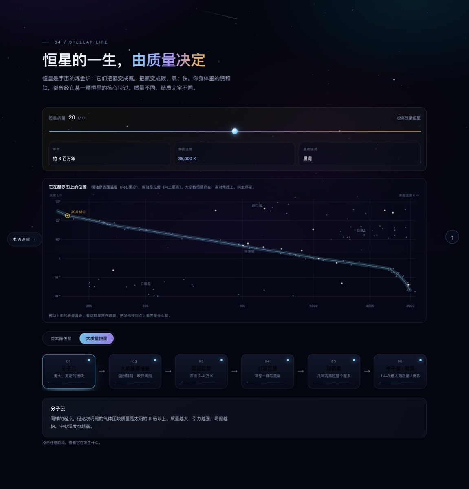
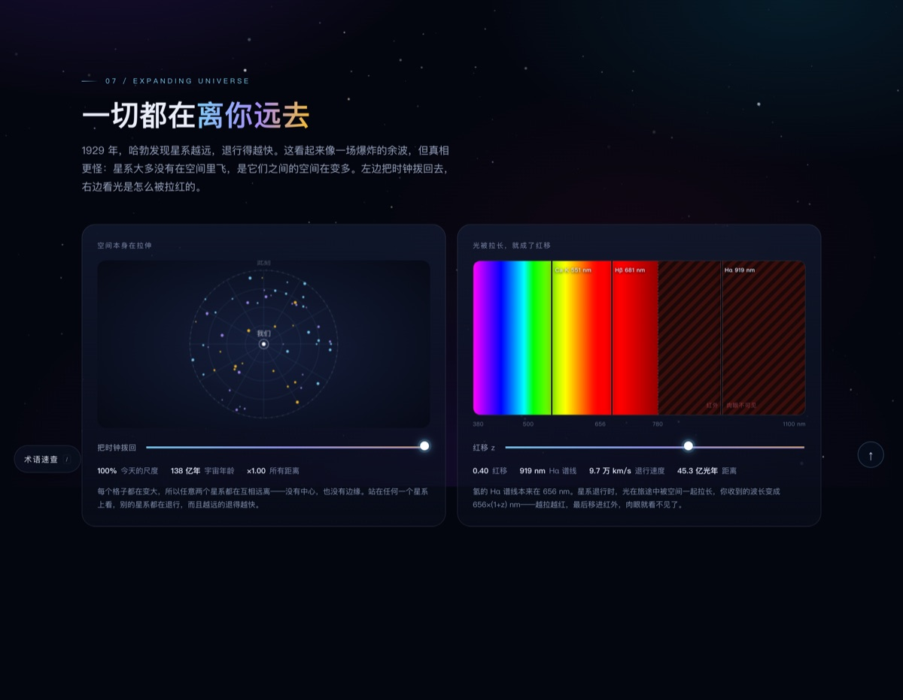

# 宇宙漫游指南 · Cosmos Field Guide

一个**单文件**的交互式宇宙科普页面：从你身体所在的一米，一路退到 930 亿光年外的可观测宇宙边缘。没有构建步骤、不依赖任何外部资源，双击 `index.html` 就能离线打开。

**[在线预览 →](https://szluyu99.github.io/cosmos-guide/)** ｜ [打印版讲义（PDF）](cosmos-guide.pdf)


## 先花 30 秒

没时间细看时，点首屏的「⚡ 30 秒速览」：六句话、每句 5 秒，先把框架建立起来——138 亿年的历史、930 亿光年的尺度、26 个数量级的跨度、95% 的未知，以及一个还在加速的宇宙。


## 十个章节

| # | 章节 | 交互 |
|---|---|---|
| 01 | **尺度之旅** | 对数滑杆遍历 10 个尺度场景（人 → 城市 → 地球 → 太阳系 → 银河系 → 宇宙网 → 可观测宇宙），相邻场景按高斯权重交叉淡入 |
| 02 | **太阳系** | 8 颗行星按真实周期比运转，可切 1× / 4× / 12× 速度，点行星看数据卡 |
| 03 | **宇宙简史** | 9 个纪元，左侧球体形态随纪元变形，可自动播放 |
| 04 | **恒星的一生** | 质量滑块 0.1–40 M☉，实时给出温度、寿命、结局；赫罗图上标记当前位置 |
| 05 | **宇宙配方** | 暗能量 / 暗物质 / 普通物质占比环，悬停高亮 |
| 06 | **宇宙日历** | 138 亿年压成 365 天，可拖动、可播放，日期精确到秒 |
| 07 | **宇宙在膨胀** | 拖尺度因子看年龄回溯；拖红移看谱线如何被拉向红端 |
| 08 | **我们怎么知道** | 视差、标准烛光、红移、微波背景——四把尺子各自的原理与极限 |
| 09 | **系外行星** | 1995 年至今的发现数量曲线 + 凌星法亮度变化动画 |
| 10 | **自测** | 7 道题，错题回顾，可只重做错题 |

|  |  |
|---|---|
| <br><sub>01 · 尺度之旅：一路拖到银河系</sub> | <br><sub>04 · 恒星的一生：质量滑块与赫罗图联动</sub> |
| <br><sub>06 · 宇宙日历：拖到 12 月 31 日</sub> | <br><sub>07 · 宇宙在膨胀：红移 0.4 时的谱线</sub> |
| <br><sub>09 · 系外行星：发现曲线与凌星亮度</sub> | <br><sub>30 秒速览：六句话建立框架</sub> |

## 三个横向层

- **30 秒速览**：全屏幕布，5 秒一页自动翻页，可暂停、可键盘控制，看完后按钮变成「再看一遍」
- **术语速查**：24 条术语，按 `/` 打开，支持搜索（中文、英文、释义都能搜），点章节名跳回原文并高亮标题
- **学习进度**：记录读过哪几章、上次测验成绩与错题，存在浏览器本地，可一键清空

## 一些细节

- **深浅双主题**：右上角 ◐ 切换，`?theme=paper` / `?theme=dark` 可强制指定；浅色模式下观测图面板保持深色，当作书本插图
- **深链分享**：`?m=star&mass=20`、`?d=363`（日历第 363 天）、`?z=0.4`（红移 0.4）、`?year=2010`（系外行星年份）等，参数会同步回地址栏
- **无障碍**：跳转链接、可见焦点环、`aria-labelledby`、canvas 的 `role="img"`、正文对比度全部达到 WCAG AA（349 个文本节点最低 4.69:1）
- **可打印**：打印样式会去掉幕布、导航、交互控件，输出白底黑字的纯文字讲义（`cosmos-guide.pdf` 即打印产物，10 页）
- **零依赖**：一个 HTML 文件，内联 CSS + 一个 IIFE，没有框架、没有 CDN、没有图片资源

## 说明

- 数据来自 Planck 2018、COBE/FIRAS、SH0ES、IAU 等公开结果，页脚「数字与出处」列出了每个关键数字的来源与年份；哈勃常数 67.4 与 73.0 的分歧在页内有注明
- 轨道半径与行星大小做了压缩，否则在同一张图里画不出来，页内也标了这一点
- 时间换算（宇宙日历）按 138 亿年 = 365 天等比折算，1 天 ≈ 3780 万年

## 本地打开

```bash
open index.html          # macOS，直接双击也行
# 或起一个本地服务（深链的地址栏规范化需要 http(s)，file:// 下会被跳过）
python3 -m http.server 8000
```

## 许可

文字与图表内容可自由转载，注明出处即可；代码部分（HTML/CSS/JS）如要复用，建议按 MIT 处理——目前仓库还没有 LICENSE 文件，需要的话我可以补一个。
